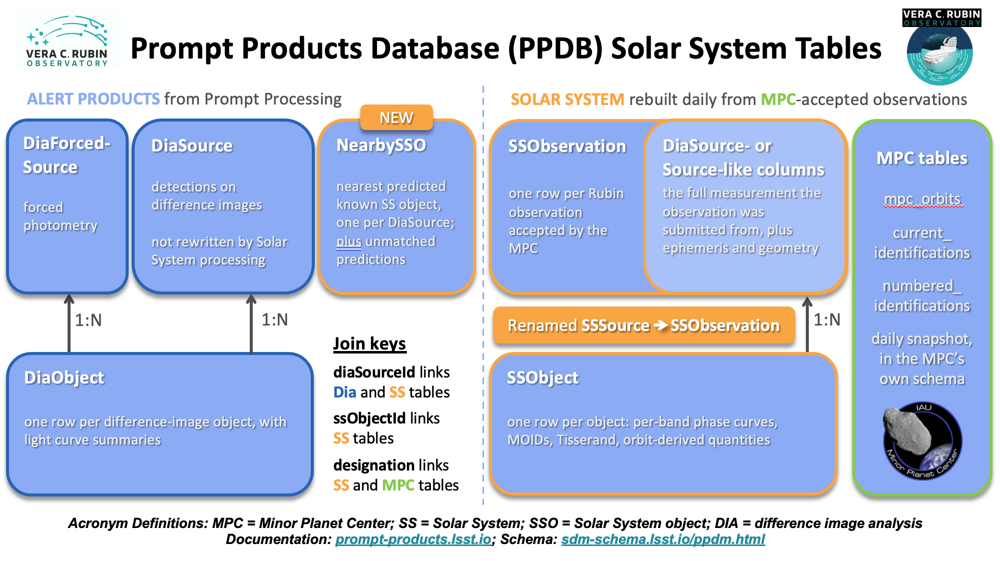

.. _moving:

#############################
Solar System Processing (SSP)
#############################

Solar System Processing includes both the association of known Solar System Objects (SSOs) during nighttime observations (see the :doc:`/processing/association/index` page) as well as the discovery of new SSOs by linking unassociated ``DiaSources`` during daytime processing.
Rubin reports its SSO observations and discoveries to the Minor Planet Center (MPC).
The MPC identifies the observations, assigns designations, and computes the orbits of all known objects.
Rubin computes per-object properties, such as per-band absolute magnitudes, from its observations accepted by the MPC.
Single-night detections not yet linked to an object (singletons) are currently not being submitted to the MPC, at the MPC's request.

General overview of SSP
=======================

.. toctree::
    :maxdepth: 1
    :titlesonly:
    :glob:

    ss_prompt
    ss_linking

Solar System processing consists of two key components: the association of observations (sources) with known solar system objects, and the discovery of previously unknown objects by linking sets of tracklets, where a tracklet is defined as two or more observations taken in close succession in a single night.

To generate expected positions for known objects, ephemerides are computed for all objects found in the Minor Planet Center orbit catalog using the ASSIST integrator (`Holman et al. 2023 <https://github.com/matthewholman/assist>`_) in the ``Sorcha`` survey simulation toolkit (`Merritt et al. 2025 <https://github.com/dirac-institute/sorcha>`_).
To enable fast lookup of objects potentially present in an observed visit, ``Sorcha`` uses the ``mpsky`` package (M. Juric 2025).
In each difference image resulting from :doc:`/processing/dia/index` processing, the closest ``DIASource`` within 1 arcsecond of a known solar system object’s predicted position is associated to that object (for details, see the :doc:`/processing/association/index` page).

Solar system object discovery uses the ``heliolinx`` package of asteroid identification and linking tools (`A. Heinze et al. 2023 <https://ui.adsabs.harvard.edu/abs/2023DPS....5540503H/abstract>`_).
The suite consists of the following tasks:

- Tracklet creation with ``make_tracklets``
- Multi-night tracklet linking with ``heliolinc``
- Linkage post processing (orbit fitting, outlier rejection, and de-duplication) with ``link_purify``

Tracklet creation with ``make_tracklets`` uses an upper limit angular velocity of 1.5 deg/day, faster than any main belt asteroid and in the range of many NEO discoveries.
To avoid excessive false tracklets from fields observed many times per night, the minimum tracklet length is set to three and the minimum on-sky motion for a valid tracklet is set to five arcseconds.

The heart of the discovery pipeline is the ``heliolinc`` task, which connects (“links”) tracklets belonging to the same object over a series of nights.
It employs the HelioLinC3D algorithm (`S. Eggl et al. 2020 <https://ui.adsabs.harvard.edu/abs/2020DPS....5221101E/abstract>`_; `A. Heinze et al. 2022 <https://ui.adsabs.harvard.edu/abs/2022DPS....5450404H/abstract>`_), a refinement of the original HelioLinC algorithm of `M. J. Holman et al. (2018) <https://ui.adsabs.harvard.edu/abs/2018AJ....156..135H/abstract>`_.
The ``heliolinc`` run tests each tracklet with 324 different hypotheses spanning heliocentric distances from 1.5 to 9.8 au and radial velocities spanning the full range of possible bound orbits (eccentricity 0.0 to nearly 1.0).
This range of distances encompasses all main belt asteroids and Jupiter Trojans, as well as many comets and Mars-crossers and some NEOs.
Smaller heliocentric distances are not attempted, because nearby objects move rapidly across the sky and hence were not likely to remain long enough in the field to be discovered.
A clustering radius is chosen corresponding to :math:`1.33 \times 10^{-3}` au at 1 au from Earth.
Linkages produced by ``heliolinc`` are post-processed with ``link_purify`` into a final non-overlapping set of candidate discoveries, ranked from highest to lowest probability of being a real asteroid based on astrometric orbit-fit residuals and other considerations.

Prompt Products Database Solar System Tables
============================================

The PPDB's Solar System tables are rebuilt every day.
They fall into three groups:

- **Rubin's observations and objects**: ``SSObservation`` and ``SSObject``.
  These are built only from Rubin observations that the Minor Planet Center (MPC) has accepted.
  Besides alert production, they include observations from reprocessed earlier data (e.g., DP1 and DP2).
- **Predictions near Rubin detections**: ``NearbySSO``.
  It is built from every ``DiaSource`` in the PPDB and the current MPC orbits.
- **MPC reference tables**: ``mpc_orbits``, ``current_identifications``, and ``numbered_identifications``.
  These are daily, unmodified copies of tables from the `MPC database <https://data.minorplanetcenter.net/mpcops/documentation/replicated-tables-schema/>`_ and keep the MPC's definitions.

The PPDB's ``DiaSource`` table holds the alerts from 2025 October 24 onwards.

.. list-table::
   :header-rows: 1
   :widths: 30 70

   * - Table
     - Contents
   * - :doc:`SSObservation </products/catalogs/ss_observation>`
     - One row per Rubin observation accepted by the MPC, with the measurement it was submitted from (a ``DiaSource`` or a ``Source``) and the object's predicted position.
   * - :doc:`SSObject </products/catalogs/ss_object>`
     - One row per object with at least one accepted Rubin observation: observation counts, per-band phase-curve fits, and orbit-derived quantities.
   * - :doc:`NearbySSO </products/catalogs/nearby_sso>`
     - For each ``DiaSource``, the nearest known object predicted within 5 arcseconds (15 for comets); also predictions that matched no ``DiaSource``.
   * - :doc:`mpc_orbits </products/catalogs/mpc_orbits>`
     - The MPC's orbit catalog: orbital elements and fit information.
   * - :doc:`current_identifications </products/catalogs/current_identifications>`
     - The MPC's mapping between designations of the same object (primary and secondary provisional designations).
   * - :doc:`numbered_identifications </products/catalogs/numbered_identifications>`
     - The MPC's mapping between permanent numbers and primary provisional designations.

The tables join on these keys:

- ``ssObjectId``: ``SSObject``, ``SSObservation``, and ``NearbySSO``.
- ``designation``: the same three tables and ``mpc_orbits``.
- ``diaSourceId``: ``NearbySSO`` and ``DiaSource``.

.. tip::

   New to these tables? The :doc:`/solar-system/index` guide explains how they fit together, what they contain, and how to use them, with example queries.
