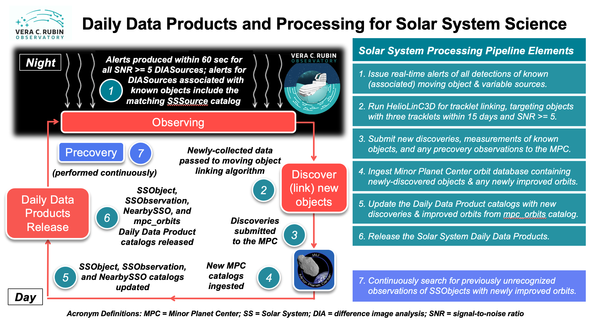

.. _moving-prompt:

##############################
Solar System prompt processing
##############################

The goal of the nightly Solar System Processing (SSP) pipeline is to link (identify) previously unknown ``SSObjects``, given an additional night of observing, and report the discoveries to the `Minor Planet Center <https://minorplanetcenter.net>`_ (MPC), as well as to compute physical (e.g., absolute magnitudes) and other auxiliary properties (e.g., predicted apparent magnitudes and coordinates in various coordinate systems) for known Solar System objects and their LSST observations.

The majority of the pipeline's processing occurs in daytime, after a night of observing.
The pipeline will deliver daily data products for Solar System objects in the form of catalogs: ``SSObject``, ``SSObservation``, ``NearbySSO``, ``mpc_orbits``, ``current_identifications``, and ``numbered_identifications``, which are described in the :doc:`/products/catalogs/index` documentation.
The SSP pipeline is illustrated in the infographic provided above.
For more information on the moving object tracklet linking and orbit fitting algorithm, see :doc:`/processing/moving/ss_linking`.

The 24 hour processing cycle
============================

During operations, the pipeline will consist of the following steps that will repeat every 24 hours.

During nightly observing:

1. Known Solar System objects are associated with difference image detections in real-time. Alerts are produced within 60 seconds for all signal-to-noise ratio (SNR)>=5 ``DiaSources``. The Alert Production pipeline attempts association of ``DiaSources`` with known Solar System objects in real-time, and if a match is found then the alert records the object's designation. For details on Solar System object association, see the :doc:`/processing/association/index` page.

During the day following nightly observing:

2. ``DiaSources`` (SNR>=5) detected on the previous night that are not associated with a known Solar System object are passed to the HelioLinC3D moving object linking pipeline. It builds tracklets (detections of the same object within a single night) and links tracklets from different nights (at least three tracklets within 15 days) into candidates consistent with a single Keplerian orbit around the Sun. For more information on this algorithm, see :doc:`/processing/moving/ss_linking`.

3. Measurements of known objects and new discoveries are submitted to the Minor Planet Center (MPC) in the standard ADES format. Single-night detections that cannot yet be identified with an object (singletons) are currently held at the MPC's request.

During the day before the coming night’s observing:

4. A snapshot of the Minor Planet Center (MPC) database is taken: its orbit catalog and designation tables (delivered as ``mpc_orbits``, ``current_identifications``, and ``numbered_identifications``), which reflect the discoveries and observations reported by all programs, and the MPC's record of Rubin's accepted observations (observatory code X05).

5. The daily data product catalogs (PPDB) are rebuilt from this snapshot. The ``SSObservation`` catalog holds all of Rubin's observations accepted by the MPC, each with the measurement it was submitted from, independent of the PPDB ``DiaSource`` table. The ``NearbySSO`` catalog holds the nearest predicted known Solar System object for each ``DiaSource``, and the predictions on (or within 30" of) a detector that matched no ``DiaSource`` (with a NULL ``diaSourceId``). The per-object quantities in ``SSObject`` (per-band absolute magnitudes and phase-curve slopes, extendedness summaries, and orbit-derived quantities such as the Earth MOID and the Tisserand parameter) are recomputed, and the predicted positions and magnitudes in ``SSObservation`` and ``NearbySSO`` are recomputed from the current orbits.

6. The Solar System daily data products (``SSObject``, ``SSObservation``, ``NearbySSO``, ``mpc_orbits``, ``current_identifications``, and ``numbered_identifications`` tables) are released.

7. Precovery linking is attempted for all ``SSObjects`` whose orbits were updated in the above process (or are new). Where successful, newly discovered observations are queued up for submission to the Minor Planet Center.

Production of Solar System PPDB tables
======================================

.. image:: images/LSST-Solar-System-Processing-Infographic-PPDB-production.png

The above infographic illustrates the process by which the Solar System PPDB tables are produced (see step 5 above).

The LSST Camera raw images are input the prompt processing pipeline to perform difference imaging and generate alerts.

The alerts are kept in the Alert Production Database (APDB; schema: `<https://sdm-schemas.lsst.io/apdb.html>`_).
See the :doc:`/processing/association/index` page for more information on the association of known Solar System Objects (SSOs) during nighttime observations.

The Prompt Products Database (PPDB) contains the same data (and more) as the APDB accumulated and queryable. This includes the ``DiaSource``, ``DiaObject``, ``DiaForcedSource``, and Solar System tables.

The ``DiaSource`` catalog from the PPDB is ingested into the ssp-tools build along with the shutter timing information, visit table, and MPC tables.
``ssp-tools`` then matches each MPC-accepted Rubin observation to its ``DiaSource`` or ``Source`` measurement, computes ephemerides for all known Solar System objects using the ASSIST integrator, and performs internal checks.
Shutter timing corrections are included in the ``SSObservation`` and ``NearbySSO`` tables; the ``DiaSource`` and past MPC submissions use the visit midpoint.
The daily Solar System data products (i.e., the Solar System PPDB tables) are then generated.

The Solar System PPDB tables include ``SSObservation``, ``SSObject``, ``NearbySSO``, ``mpc_orbits``, ``current_identifications``, and ``numbered_identifications``. For more information on each catalog, see the :doc:`/products/catalogs/index` pages.
